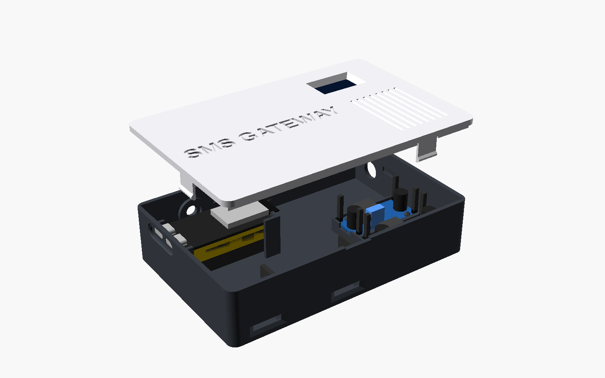
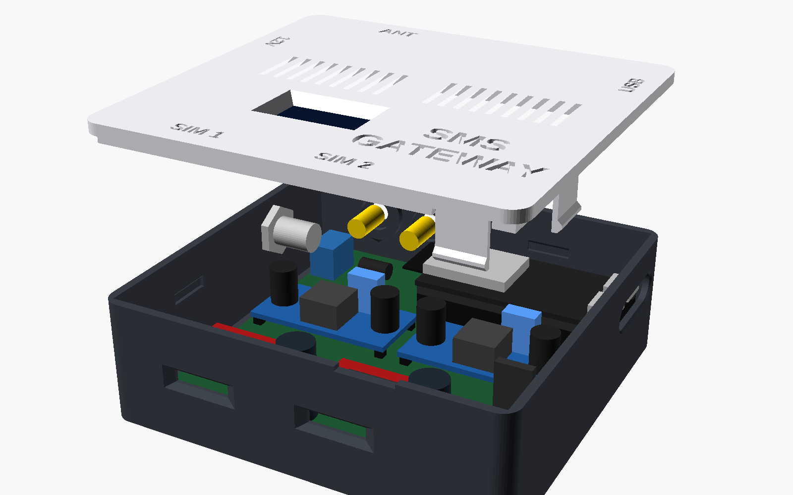
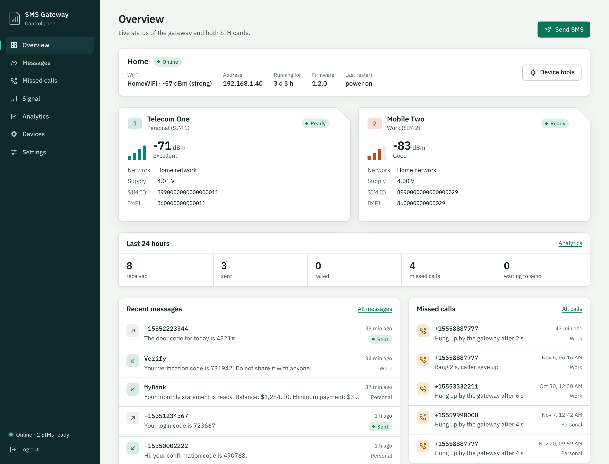
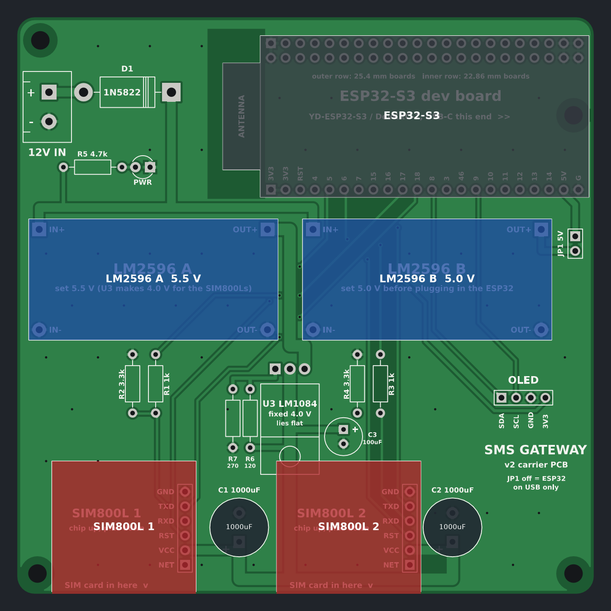
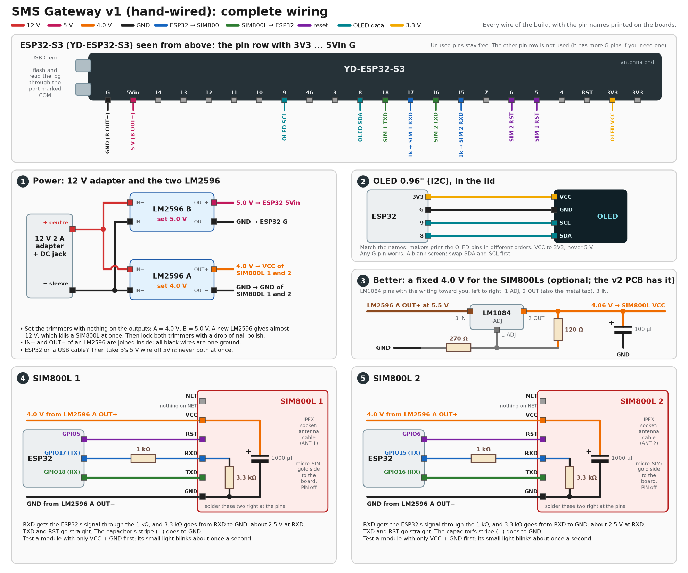

# SmsGateway (درگاه پیامک)

[English](README.md) · **فارسی**

یک **درگاه پیامک و تماس بی‌پاسخ** که خودتان می‌سازید. داخلش یک ESP32-S3 و دو ماژول SIM800L است که در یک جعبه‌ی پرینت سه‌بعدی و بدون پیچ قرار می‌گیرند. یک سرور Node.js با پنل وب هم دارد که روی سرور خودتان نصب می‌شود. دو راه برای ساختن دارد: **v1** با سیم‌کشی دستی در جعبه‌ی پرینتی، و **v2** که همه‌ی ماژول‌ها روی یک برد PCB قرار می‌گیرند و جعبه‌ی خودش را دارد.

| v1: پرینت سه‌بعدی + سیم‌کشی دستی | v2: برد PCB + پرینت سه‌بعدی |
|---|---|
|  |  |

## ایده

این یک پروژه‌ی شخصی است. حدود سه سال این ایده در ذهنم بود تا بالاخره نشستم و ساختمش.

از یک مشکل خیلی معمولی شروع شد. بعد از مهاجرت به کشوری دیگر، دو سیم‌کارت از کشور خودم را فقط برای گرفتن پیامک نگه داشتم: کدهای بانک و ورود (OTP)، اطلاعیه‌ها و گاهی یک تماس بی‌پاسخ. برای همین مجبور بودم یک گوشی قدیمی را همه‌جا همراهم داشته باشم، حواسم باشد شارژش تمام نشود، و گاهی هم درست وقتی کدی لازم داشتم، صندوق پیامکش پر بود و کد نمی‌رسید.

پس این را برای خودم ساختم: سیم‌کارت‌ها در یک جعبه‌ی کوچک که همیشه در خانه به برق وصل است و کارشان را انجام می‌دهد:

- هر پیامکی که به هر کدام از سیم‌کارت‌ها برسد، از طریق Wi-Fi به **سرور خودتان** می‌رود. تماس‌ها هم رد می‌شوند و به‌عنوان تماس بی‌پاسخ ثبت می‌شوند.
- همه چیز را از هر جایی در **پنل وب** می‌بینید: کدهای تأیید، پیامک‌های بانک، و این‌که چه کسی زنگ زده.
- یا در **تلگرام** می‌گیرید: هر سیم‌کارت به چت‌های خودش می‌رود. دستور `‎/stats` وضعیت را می‌دهد، و اگر دستگاه خاموش شود یا سیم‌کارتی آنتن از دست بدهد، هشدار می‌گیرید.
- برنامه‌های خودتان می‌توانند از طریق یک **API ساده‌ی HTTP پیامک بفرستند**، یا با رسیدن هر پیام یک **webhook** بگیرند.
- با قطعات ارزان و رایج ساخته می‌شود. سرور مال خودتان است: نه اشتراک سرویس پیامک لازم است، نه شخص دیگری پیام‌هایتان را می‌خواند.
- سیم‌کارت هیچ‌وقت پر نمی‌شود: هر پیامک بعد از این‌که سرور آن را گرفت، از روی سیم‌کارت پاک می‌شود.

بعدها امکاناتی اضافه کردم که دیگران هم لازم دارند، تا هر کسی بتواند یکی بسازد: یا به همین دلیل (سیم‌کارت‌هایی از کشوری دیگر و کدهایی که نباید از دست بروند)، یا به‌عنوان یک درگاه پیامک کوچک و شخصی برای برنامه‌های خودش.

## امکانات

- **دو سیم‌کارت**، هر کدام روی SIM800L خودش. سیم‌کارت‌ها از جلوی جعبه جا می‌روند.
- **آنتن بیرونی**: کابل IPEX به SMA، و سوکت‌های SMA روی دیواره‌ی پشت جعبه.
- **صفحه‌ی OLED ‏۰٫۹۶ اینچی** روی درِ جعبه برای نمایش وضعیت.
- **بدون پیچ**: درِ جعبه با چهار قفل جا می‌افتد و بردها با پین‌های فشاری.
- **برق ۱۲ ولت** از طریق دو LM2596: ‏۴٫۰ ولت برای ماژول‌ها و ۵ ولت برای ESP32. نسخه‌ی v2 یک رگولاتور ثابت ۴٫۰ ولت هم دارد که اجازه نمی‌دهد ولتاژ اشتباه به ماژول‌ها برسد.
- **سرور و پنل وب** (Node.js و SQLite): صندوق پیامک‌های دریافتی و ارسالی، تماس‌ها، وضعیت دستگاه، نمودار آنتن، API، وب‌هوک، تلگرام، و آپدیت فرمور از طریق Wi-Fi.
- **برای هر سیم‌کارت**: یک اسم (مثلاً «کار»)، کلیدی برای خاموش کردن اسلات خالی، و انتخاب اپراتور (خودکار، یا دستی از فهرستی که دستگاه پیدا می‌کند).

> **فقط 2G.** ‏SIM800L یک ماژول 2G (GSM) است و در خیلی از کشورها 2G دیگر خاموش شده. قبل از ساختن، از اپراتورتان بپرسید. فهرست کشورها در [SHOPPING_LIST.md](SHOPPING_LIST.md#6-caution-2g-shutdowns) است.

## پنل وب

همه‌ی کارهای دستگاه در پنل وب روی سرور خودتان دیده می‌شود. داده‌های این تصویرها ساختگی است.

  

عکس بقیه‌ی صفحه‌ها (پیامک‌ها، تماس‌ها، نمودار آنتن، آمار، دستگاه‌ها، تلگرام، تنظیمات سیم‌کارت، موبایل و حالت تیره) در [README انگلیسی](README.md#the-web-panel) و پوشه‌ی [docs/panel](docs/panel) است.

## دو روش ساخت

| | **v1: پرینت + سیم‌کشی دستی** | **v2: برد PCB + پرینت** |
|---|---|---|
| چطور | هر ماژول در جای خودش در جعبه قرار می‌گیرد و با سیم دوسرمادگی وصل می‌شود | ماژول‌ها روی یک برد جا می‌روند و سیم آزادی وجود ندارد |
| لازم دارید | پرینتر سه‌بعدی و هویه (حدود ۱۰ لحیم) | پرینتر سه‌بعدی و سفارش برد: برد خام که خودتان لحیم می‌کنید (همه‌ی قطعات پایه‌دار)، یا برد مونتاژشده در کارخانه |
| راهنما | [ASSEMBLY.md](ASSEMBLY.md) | [pcb/README.md](pcb/README.md) |

  

## وضعیت پروژه

| بخش | وضعیت |
|---|---|
| جعبه‌ی v1 | پرینت شده و در اولین نمونه استفاده می‌شود |
| سیم‌کشی v1 | ساخته شده و کار می‌کند، یک SIM800L روی شبکه |
| برد v2 | طراحی شده و بررسی طراحی بدون خطاست. فایل‌های سفارش آماده است. **هنوز سفارش داده نشده** |
| فرمور | روی سخت‌افزار واقعی کار می‌کند: هات‌اسپات راه‌اندازی، اتصال به سرور، آپدیت از طریق Wi-Fi |
| سرور | پنل، API، وب‌هوک، تلگرام، آپدیت فرمور از GitHub. ‏۳۶ تست |

## سیم‌کشی

تصویر زیر **همه‌ی سیم‌ها را یکی‌یکی** نشان می‌دهد ([اندازه‌ی کامل](docs/wiring_v1.png)):

  

خلاصه:

- آداپتور ۱۲ ولت به **IN** هر دو LM2596 (پین وسط جک مثبت است، ولی با مولتی‌متر چک کنید).
- **قبل از وصل کردن هر چیز دیگر** خروجی‌ها را با مولتی‌متر تنظیم کنید: ‏**A = ۴٫۰ ولت** برای سیم‌کارت‌ها و **B = ۵٫۰ ولت** برای ESP32. ‏LM2596 نو تقریباً ۱۲ ولت می‌دهد و ۱۲ ولت SIM800L را فوراً می‌سوزاند. بعد از تنظیم، یک قطره لاک ناخن روی پیچ‌ها بریزید.
- هر SIM800L یک خازن ۱۰۰۰ میکروفاراد بین VCC و GND خودش می‌خواهد. نوار خازن سمت GND است.
- ترتیب پایه‌های SIM800L: ‏`NET VCC RST RXD TXD GND`. به NET چیزی وصل نمی‌شود.
- سیم‌کارت ۱: ‏TXD به GPIO18، ‏RXD از راه مقاومت 1k به GPIO17، و 3.3k از RXD به GND. ‏RST به GPIO5.
- سیم‌کارت ۲: ‏TXD به GPIO16، ‏RXD از راه 1k به GPIO15، و 3.3k از RXD به GND. ‏RST به GPIO6.
- OLED: ‏VCC به 3V3 (نه ۵ ولت)، ‏GND به G، ‏SCL به 9، ‏SDA به 8.
- همه‌ی GNDها باید به هم وصل باشند.
- وقتی ESP32 با کابل USB روشن است، سیم ۵ ولت را از 5Vin جدا کنید. هیچ‌وقت هر دو را با هم وصل نکنید.

## تجربه‌ها و اشتباه‌های اولین ساخت

اولین نمونه قدم‌به‌قدم و با کلی آزمون و خطا ساخته شد. این‌ها اشتباه‌هایش است، تا ساخت شما سریع‌تر پیش برود. متن کامل به انگلیسی در [LESSONS.md](LESSONS.md) است.

- **جرقه و دو SIM800L سوخته:** خروجی LM2596 روی ۱۲ ولت مانده بود. با زدن آداپتور جرقه زد و هر دو ماژول سوختند. یکی از آن‌ها روی خازن زرد کوچکش (107C) جای سوختگی داشت. ولتاژ را بدون بار تنظیم کنید، پیچ را قفل کنید، و قبل از دست زدن به پیچ یا سیم‌های برق آداپتور را جدا کنید.
- **«پیچ را می‌چرخانم و عدد عوض نمی‌شود»:** پیچ LM2596 بین ۱۵ تا ۲۵ دور می‌چرخد. وقتی روی ولتاژ بالا تنظیم شده، تا چند دور فقط ۱۲ ولت نشان می‌دهد. به چرخاندن ادامه دهید.
- **جرقه‌ی کوچک موقع زدن فیش آداپتور عادی است:** خازن‌ها شارژ می‌شوند. ولی جرقه بین سیم‌ها یعنی اتصال کوتاه. سر سیم‌های لخت را جدا جدا چسب بزنید.
- **مقاومت‌ها جابه‌جا بودند، ماژول جواب نمی‌داد:** وقتی RXD با یک سیم مستقیم وصل شد، فوراً جواب داد. ‏1k **وسط** سیم پایه‌ی 17 می‌رود و 3.3k **از RXD به GND**. با همه چیز روشن، RXD حدود ۲٫۵ ولت نشان می‌دهد.
- **پیدا کردن سیم اشتباه:** ماژول را فقط با VCC و GND روشن کنید. چراغ کوچکش باید هر ثانیه یک بار چشمک بزند، حتی بدون سیم‌کارت. بعد TXD، ‏RXD و RST را یکی‌یکی اضافه کنید و هر بار چراغ را نگاه کنید.
- **«SIM not inserted» با سیم‌کارتی که سالم بود:** دو بار سیم‌کارت برعکس جا زده شده بود. سیم‌کارت باید Micro SIM باشد و طلایی‌هایش رو به برد. وقتی جا افتاد، نباید طلایی‌ها دیده شوند. درخواست PIN را خاموش کنید و سیم‌کارت را وقتی برق قطع است جا بزنید.
- **IMEI:** در بعضی کشورها، مثل ترکیه، ماژولی که IMEI آن ثبت نشده بعد از مدتی از شبکه قطع می‌شود. ماژول **IMEI kayıtlı** بخرید.
- **فلش کردن:** برد دو پورت USB-C دارد. با پورتی که رویش **COM** نوشته شده فلش کنید و لاگ بخوانید.
- **عوض شدن Wi-Fi:** دکمه‌ی BOOT را ۵ ثانیه نگه دارید تا هات‌اسپات راه‌اندازی دوباره باز شود. ‏ESP32 فقط Wi-Fi ‏۲٫۴ گیگاهرتز را می‌بیند.
- **سرور بعد از هر deploy همه چیز را فراموش می‌کرد:** در Coolify حافظه‌ی دائمی (volume) نبود. با Docker Compose نصب کنید. اگر خطای `Docker Compose file not found at /server/...` آمد، ‏Base Directory را `/` بگذارید.

## راه‌اندازی اول

1. فرمور را از [آخرین release](../../releases) بگیرید (`sms_gateway-esp32s3-full.bin`) و از پورت **COM** در آدرس 0x0 فلش کنید، یا با Arduino IDE بسازید. جزئیات در [firmware/sms_gateway/README.md](firmware/sms_gateway/README.md) است.
2. دستگاه یک Wi-Fi به اسم `SMS-Gateway-XXXX` باز می‌کند (رمز `smsgateway`). با گوشی به آن وصل شوید، Wi-Fi خانه و آدرس سرورتان را وارد کنید.
3. صفحه‌ی راه‌اندازی و OLED **کلید دستگاه** را نشان می‌دهند (مثل `K7Q2-M9XD-4TPA-W3HZ`). آن را در پنل در **Devices → Add a gateway** وارد کنید.
4. از این به بعد فرمور خودش از طریق Wi-Fi آپدیت می‌شود: هر روز در ساعتی که در پنل تعیین می‌کنید، یا فوراً با **Update now**.

## سرور

سرور Node.js ‏(۲۴ یا بالاتر) بدون هیچ پکیج npm. راهنمای کامل به انگلیسی در [server/README.md](server/README.md) است.

- **Coolify:** منبع جدید از همین مخزن Git، با Build Pack **Docker Compose**، ‏Base Directory ‏`/`، و فایل `/docker-compose.yaml`. دامنه را با پورت وارد کنید، مثل `https://sms.example.com:3000`. متغیر `ADMIN_PASSWORD` را تعیین کنید.
- **Docker:** ‏`ADMIN_PASSWORD=change-me docker compose up -d`
- دیتابیس در volume ‏`gateway-data` می‌ماند و با deploy دوباره پاک نمی‌شود.

## تلگرام

1. در تلگرام به **@BotFather** بروید، `‎/newbot` را بفرستید و توکنی که می‌دهد را کپی کنید.
2. در پنل به **Settings → Telegram** بروید و توکن را وارد کنید.
3. ربات را در تلگرام باز کنید و **Start** را بزنید. برای گروه، ربات را به گروه اضافه کنید و یک پیام بنویسید.
4. **Find chats** را بزنید و برای هر سیم‌کارت چت‌ها را انتخاب کنید. یک سیم‌کارت می‌تواند به چند چت برود.

- پیامک بلند که چندتکه می‌رسد، به صورت **یک پیام کامل** به تلگرام می‌رود.
- دستور `‎/stats` وضعیت همه‌ی دستگاه‌ها و سیم‌کارت‌ها را می‌دهد: آنتن، ولتاژ، اپراتور و آمار ۲۴ ساعت. فقط چت‌هایی که در تنظیمات اضافه کرده‌اید جواب می‌گیرند.
- **هشدارها** (هر کدام کلید روشن و خاموش جدا دارد): دستگاه آفلاین شد یا برگشت، و سیم‌کارت چند دقیقه بدون آنتن ماند یا برگشت.

## API

همه‌ی درخواست‌ها هدر `Authorization: Bearer <API_KEY>` لازم دارند. کلید در پنل در **Settings** است.

| | |
|---|---|
| `POST /api/v1/sms` | `{"to": "+15551234567", "text": "Hello", "sim": 0}` |
| `GET /api/v1/sms/:id` | status of one message |
| `GET /api/v1/messages?direction=in&since_id=` | inbox / outbox |
| `GET /api/v1/calls` | missed calls |
| `GET /api/v1/status` | gateway and SIM status |

وب‌هوک‌ها برای هر رویداد یک درخواست POST امضاشده می‌فرستند: `sms.received`، ‏`sms.sent`، ‏`sms.failed`، ‏`call.missed`، ‏`device.offline`، ‏`device.online`.

## مجوز

[MIT](LICENSE)

