# SmsGateway

**English** · [فارسی](README.fa.md)

A DIY two-SIM **SMS and missed-call gateway**: an ESP32-S3 with two SIM800L GSM modules in a
3D-printed, screwless case, plus a self-hosted Node.js server with a web panel. Build it the way
that suits you: **v1** is hand-wired in a printed case, **v2** puts everything on a PCB in its own
printed case.

| v1: 3D print + hand wiring | v2: PCB + 3D print |
|---|---|
| 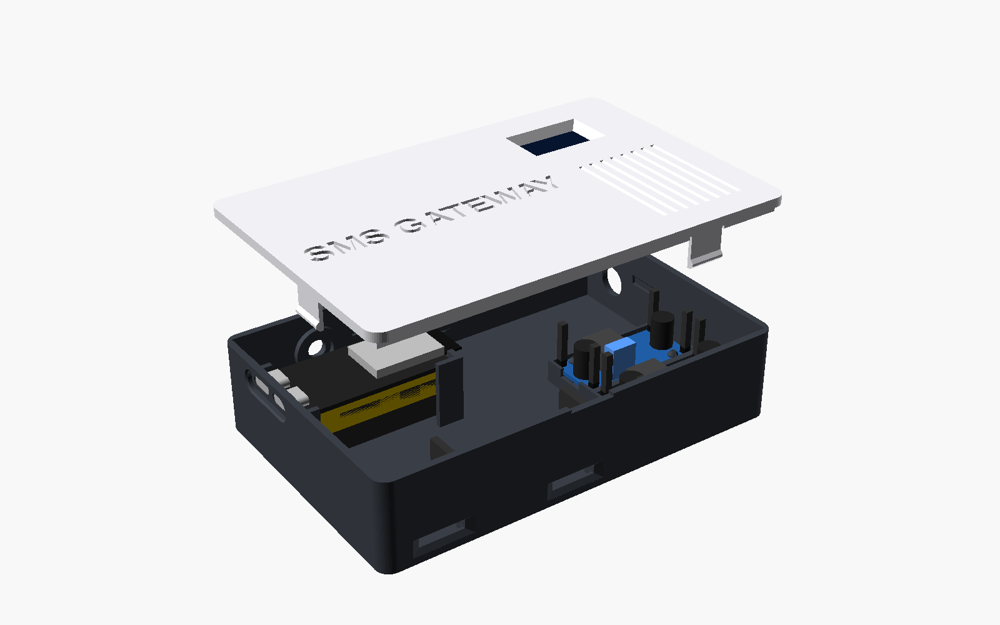 | 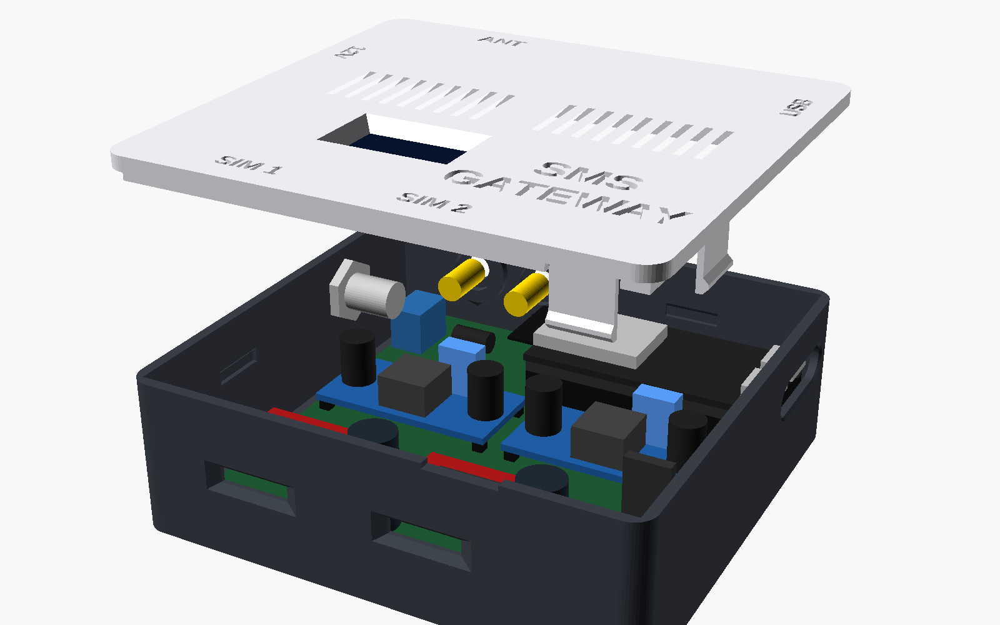 |

All case images are rendered from the OpenSCAD source in `source/`.

## The idea

This is a hobby project. I carried the idea around for about three years before I finally sat
down and started building it.

It started with a very ordinary problem. After moving to another country, I kept two SIM cards
from home only to receive messages: bank and login codes (OTP), notices, and the odd missed call.
That meant carrying an old phone around just for them, remembering to charge it, and finding its
SMS inbox full at the worst moment, with a code that never arrived.

So I built this for myself: put the SIM cards in one small box that stays plugged in at home and
takes care of them:

- Every SMS that arrives on either SIM goes over Wi-Fi to **your own server**, and so does every
  incoming call (rejected and logged as a missed call).
- You read everything in a **web panel from anywhere**: verification codes, bank messages, who called.
- Or get them in **Telegram**: each SIM can go to its own chats, a one-time code is one tap to copy,
  and a reply to an SMS goes back to its sender from the same SIM. `/stats` answers with the status,
  `/balance` with the balance, and you get an alert when the gateway goes offline or a SIM loses
  the network.
- The SIM cards stay alive: the gateway can check their balance and send an SMS now and then, so
  the operator does not switch off a prepaid SIM that is rarely used. A SIM that is roaming can be
  set to cost nothing: calls ring instead of being hung up, and it sends no SMS.
- Your own apps can **send SMS** through a small HTTP API, or get a **webhook** the moment a
  message arrives.
- It is built from cheap off-the-shelf parts (an ESP32 and two SIM800L modules) in a 3D-printed
  case, and the server is self-hosted: no SMS service subscription, and no third party reading
  your messages.
- The SIM cards never fill up: each SMS is deleted from the card once the server has it.

Later I added what others would need too, so anyone can build one: for the same reason (SIM cards
from another country, codes you must not miss), or simply as a small self-hosted SMS gateway for
their own apps, with the HTTP API, webhooks and Telegram.

## Features

- **Two SIM cards**, each on its own SIM800L, cards slide in from the outside through the front wall.
- **External antennas**: IPEX to SMA bulkhead cables, SMA sockets in the back wall.
- **0.96" OLED** in the lid for status.
- **Screwless case**: snap latches on the lid, snap pins for the boards, crush ribs, no inserts.
- **Powered from 12 V** through two LM2596 bucks (4.0 V for the modems, 5 V for the ESP32). The v2
  PCB adds a fixed 4.0 V regulator, so a mis-set buck cannot reach the modems.
- **Server + web panel** (Node.js, SQLite): SMS inbox/outbox, calls, device status, HTTP API,
  webhooks, Telegram forwarding per SIM, firmware updates over Wi-Fi.
- **Search and export**: filter messages and calls by SIM and days, download them as CSV.
- **Telegram**: forwarding per SIM with filters (only codes, skip senders or words), replies and
  `/send`, `/stats`, `/balance`, alerts.
- **Per SIM**: a name ("Work"), a switch to turn an empty slot off, the mobile network (automatic,
  or one you pick from a search), the balance (USSD code, checked by hand or every few days), a
  keep-alive SMS, and a roaming mode that saves money abroad (calls ring instead of being hung up,
  no SMS goes out).

> **2G only.** The SIM800L is a 2G (GSM) module. Many countries have already switched 2G off.
> Check your operator before you build one, see [2G shutdowns](SHOPPING_LIST.md#6-caution-2g-shutdowns).

## The web panel

Everything the gateway does shows up in a web panel on your own server. (The pictures use made-up
demo data.)

<p align="center">
  
</p>

| Messages | Missed calls |
|---|---|
| 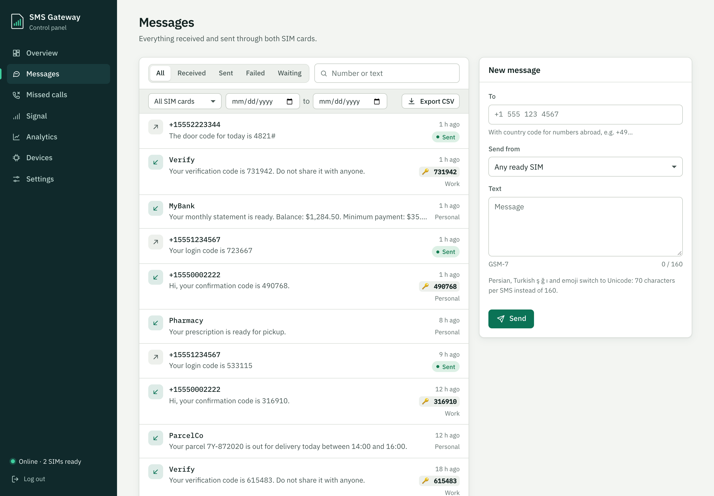 | 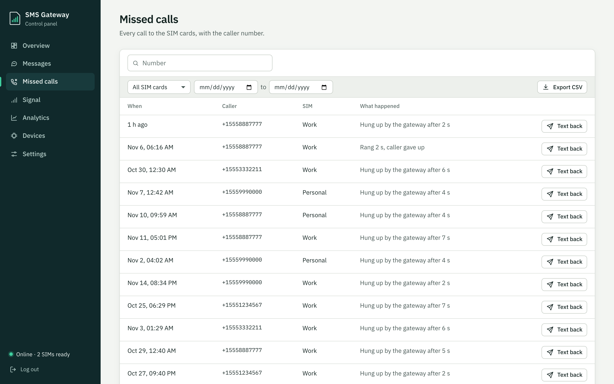 |
| **Signal** | **Analytics** |
| 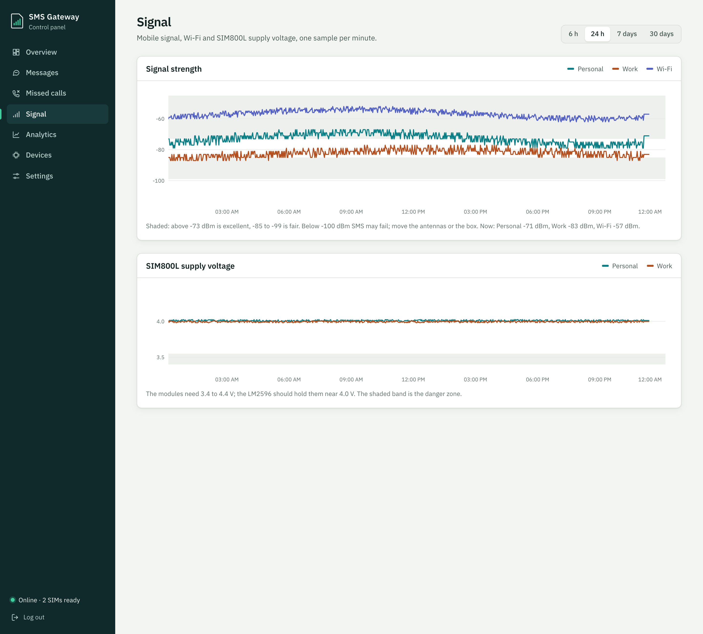 | 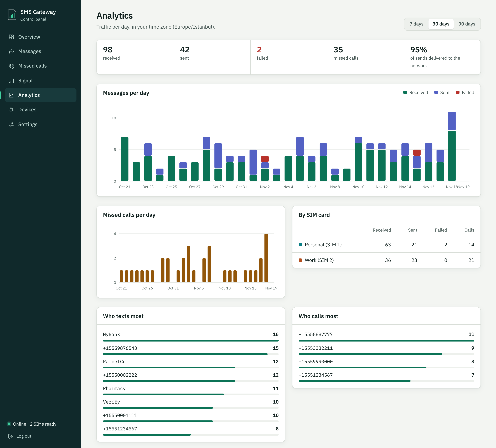 |
| **Devices** | **Telegram** |
| 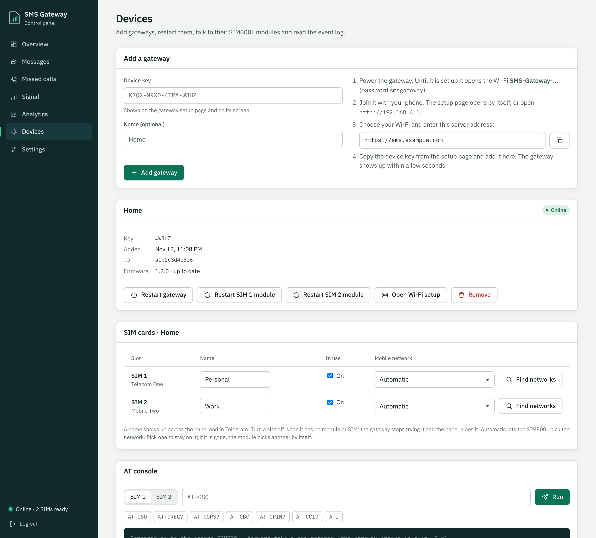 | 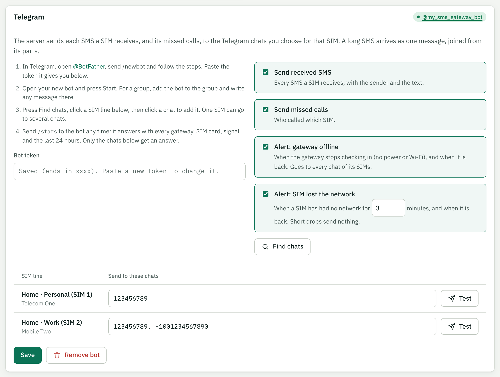 |
| **SIM cards: name, network, roaming, balance, keep-alive** | **Phone and dark mode** |
| 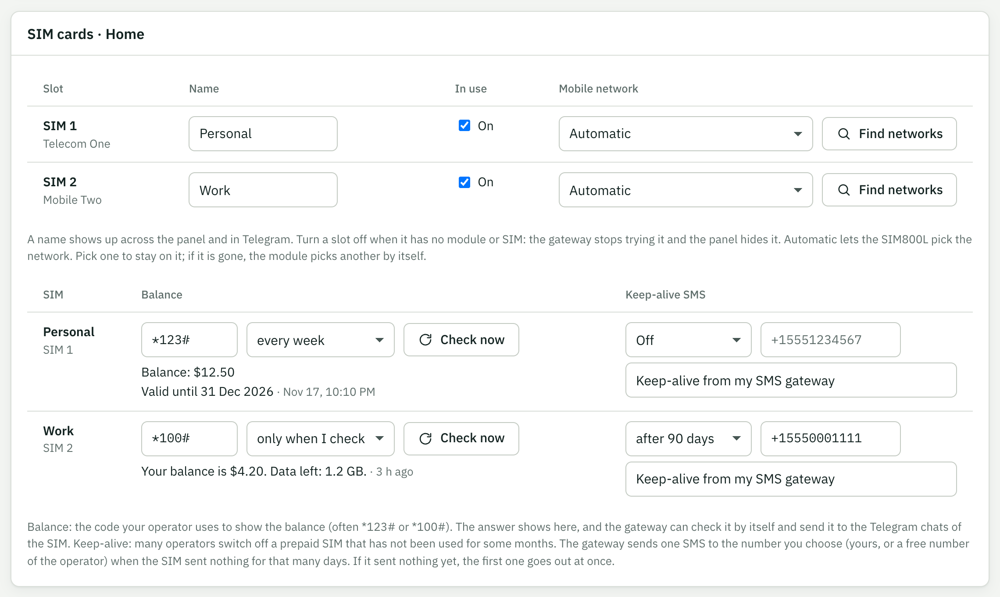 | 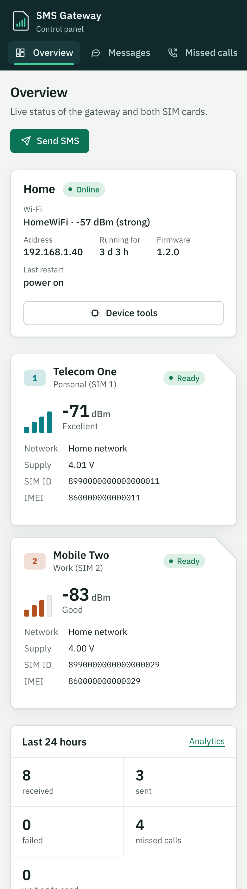 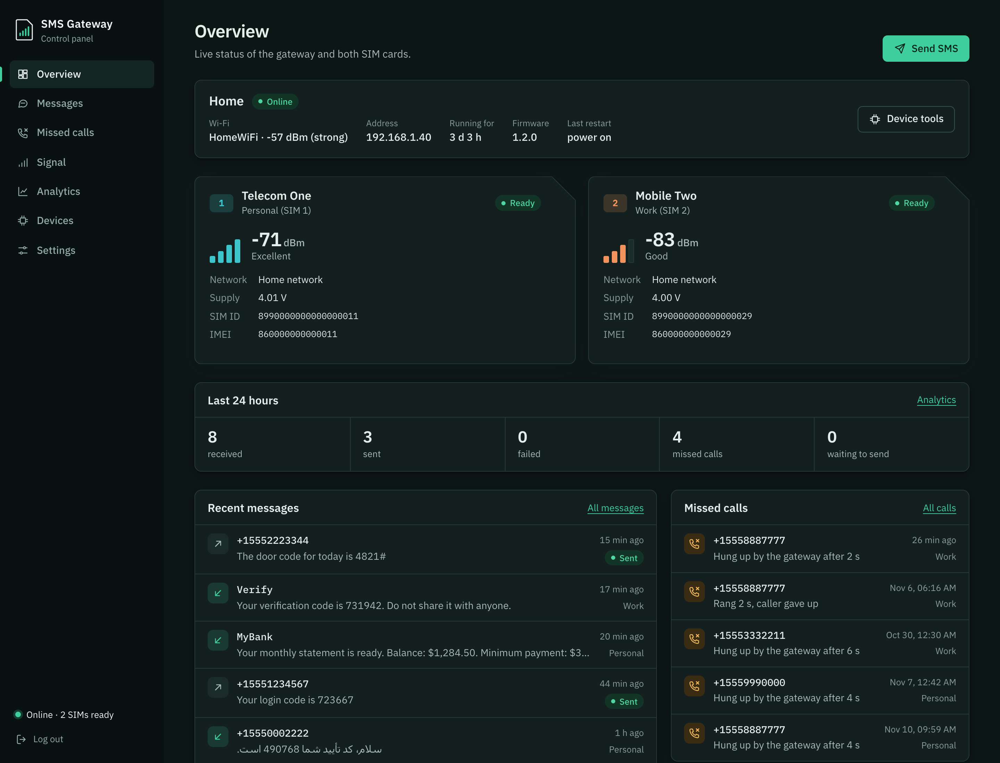 |

## Two ways to build it

| | **v1: 3D print + hand wiring** | **v2: PCB + 3D print** |
|---|---|---|
| How | Each module clicks into its own printed bay and is wired with Dupont jumpers | The modules plug into one carrier PCB, so there are no loose wires |
| You need | A 3D printer and a soldering iron (about 10 joints) | A 3D printer and a PCB order: bare boards you solder (all through-hole), or boards assembled by the factory |
| Case | `case/v1/`, 148.8 x 96.8 x 32.4 mm | `case/v2/`, 113.2 x 105.8 x 35 mm |
| Guide | [ASSEMBLY.md](ASSEMBLY.md) | [pcb/README.md](pcb/README.md) |
| Good for | Building one gateway from parts you already have | A tidier, sturdier box, or building several |

Both use the same modules, OLED, antennas, 12 V jack and adapter, and run the same firmware and
server.

### The v2 carrier PCB

<p align="center">
  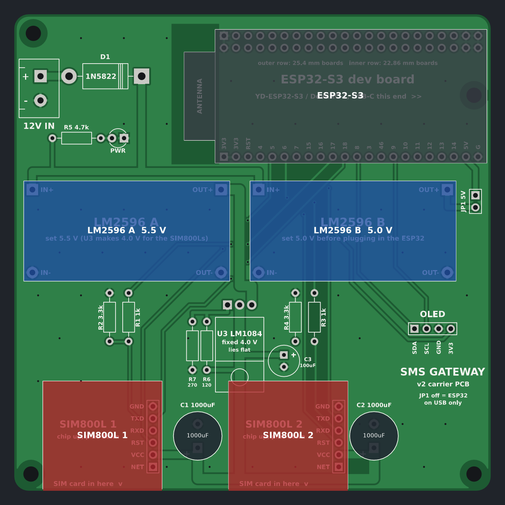
</p>

| Top | Bottom |
|---|---|
| 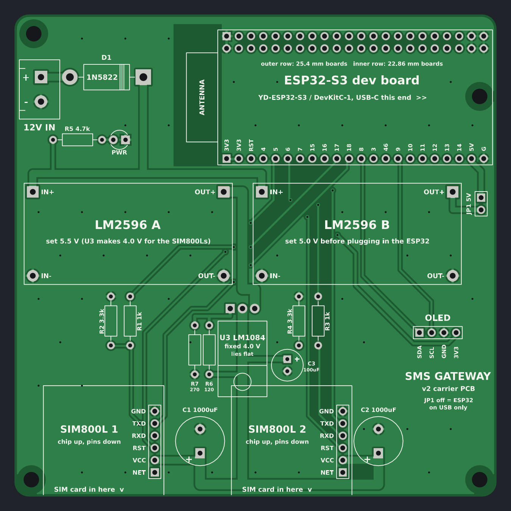 |  |

100 x 100 mm, 2 layers, all through-hole. The modules plug in, so there is no loose wiring. The
SIM800Ls get a fixed 4.0 V from an LM1084 regulator, so a mis-set LM2596 cannot reach them.

**Want assembled boards (PCBA)?** Everything is ready: send
`pcb/sms_gateway_v2_order_package.zip` to a PCB factory. It holds the Gerbers, BOM,
pick-and-place file, assembly drawing and order specs. For bare boards, upload
`pcb/sms_gateway_v2_gerbers.zip`. See [pcb/README.md](pcb/README.md#ordering-everything-is-ready).

## Project status

| Part | State |
|---|---|
| v1 case | Printed and used for the first build: the modules, the OLED and the 12 V jack fit. Antennas not fitted yet |
| v1 wiring | Built and running, one SIM800L on the network. [ASSEMBLY.md](ASSEMBLY.md) has the wiring and a guide for when something does not work |
| v2 PCB | Designed, design check clean (clearances, connections), order files ready. Updated after the first build with a fixed 4.0 V regulator for the SIM800Ls. **Not yet ordered or built** |
| v2 case | Designed, collision-checked against models of the boards. **Not yet printed** |
| Firmware | Runs on real hardware: setup hotspot, pairing, server sync, updates over Wi-Fi, a SIM800L registered on the network. Bench-test sketch included |
| Server | Web panel, HTTP API, webhooks, Telegram, firmware updates from GitHub releases, 44 passing tests. Runs with a real gateway |

## Repository layout

```
case/v1/            v1 (hand-wired) print files: STL + 3MF of every part, renders
case/v1/bambu/      ready-to-print Bambu Studio plates + the process profile
case/v2/            v2 (PCB) print files: STL + 3MF of every part, renders
pcb/                v2 carrier PCB: Gerbers, BOM, pick-and-place, assembly drawing, order package,
                    KiCad file, renders, and make_board.py that generates all of it
source/             OpenSCAD source of both cases (sms_gateway_box_v1.scad, sms_gateway_box_v2.scad)
firmware/           Arduino sketches: sms_gateway (the gateway), sim800_test (bench test)
server/             Node.js server and web panel (Dockerfile for Coolify / Docker)
docs/panel/         screenshots of the web panel (demo data)
ASSEMBLY.md         v1: where every part sits, power and signal wiring, assembly order, troubleshooting
LESSONS.md          mistakes from the first build and how to avoid them
SHOPPING_LIST.md    parts list for both builds, antennas, power notes, SIM cards, 2G shutdowns
```

## Hardware

| Part | Qty |
|---|---|
| ESP32-S3 dev board (YD-ESP32-S3, 2x USB-C, 28 mm wide) | 1 |
| SIM800L module with IPEX antenna socket | 2 |
| LM2596 buck module (43 x 21 mm) | 2 |
| 0.96" SSD1306 I2C OLED, 128x64, 4 pins (VCC GND SCL SDA) | 1 |
| 1000 uF 16 V low-ESR electrolytic capacitor (max 10.5 x 21 mm) | 2 |
| IPEX (u.FL) to SMA-female bulkhead cable, 12-15 cm | 2 |
| GSM antenna, SMA **male** (not RP-SMA) | 2 |
| DC-099 panel jack 5.5 x 2.1 mm + 12 V 2 A adapter | 1 |
| Micro-SIM with voice + SMS, works on 2G, PIN lock off | 2 |
| **v1 only:** resistors 1 k and 3.3 k (RX level dividers), female-female Dupont jumpers 20 cm | 2 + 2, ~20 |
| **v1, recommended:** LM1084IT-ADJ + 120 Ω + 270 Ω + 100 uF for a fixed 4.0 V (see [ASSEMBLY.md](ASSEMBLY.md)) | 1 set |
| **v2 only:** the carrier PCB and its parts (headers, terminal, diode, regulator, LED, resistors), 4 F-F jumpers for the OLED | see [pcb/README.md](pcb/README.md) |

Full list with alternatives and search terms: [SHOPPING_LIST.md](SHOPPING_LIST.md).

## 3D-printed cases

Both cases print in PLA on a 0.4 mm nozzle with no supports, and both are screwless: the lid
clicks on with 4 snap latches.

### v1 case (hand-wired)

| Front | Back |
|---|---|
| 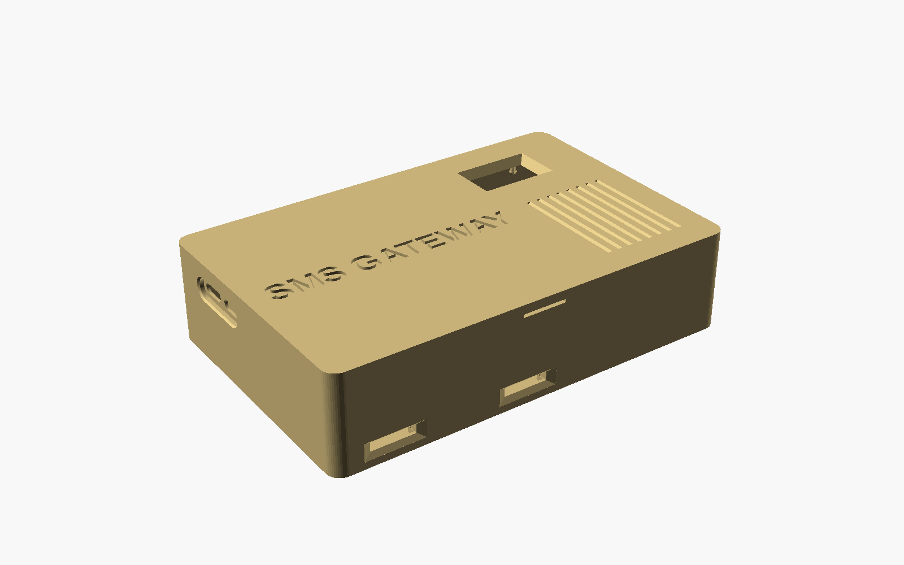 | 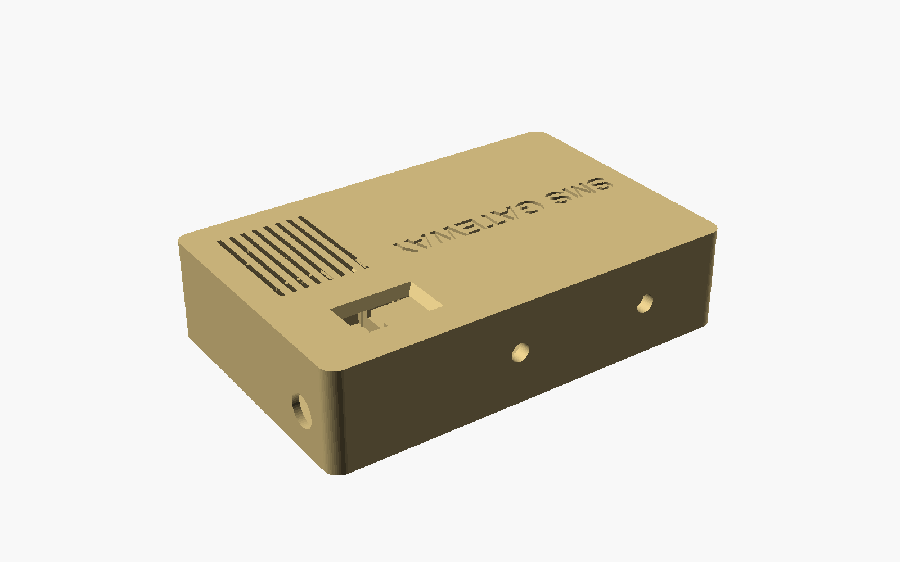 |
| **Inside** | **X-ray (lid transparent)** |
| 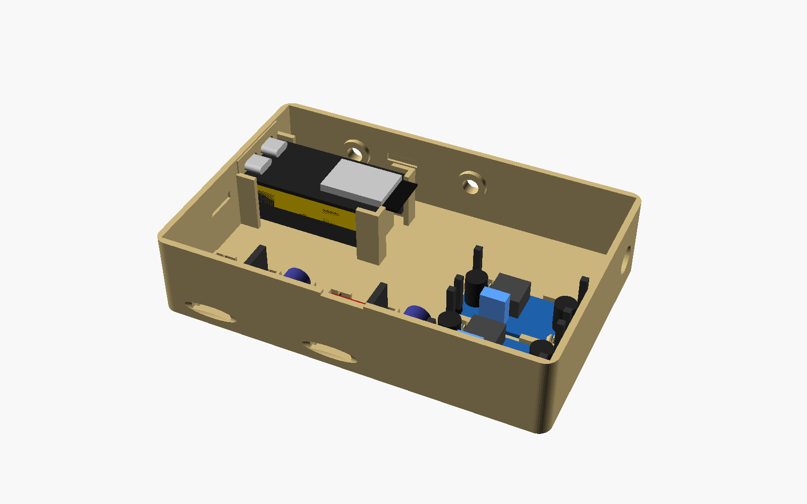 |  |

Outside size 148.8 x 96.8 x 32.4 mm + 3.2 mm lid.

1. **Fit tests first**: `case/v1/bambu/1_fit_tests_X2D.3mf` (lid latch, LM2596, SIM800L, OLED,
   ESP32, antenna hole + the OLED plug holder). Check every board fits. On the antenna test, fit
   the real SMA connector (body in the pocket inside, washer + nut outside) and screw the antenna on.
2. **Box**: `case/v1/bambu/2_box_X2D.3mf` (opening up).
3. **Lid**: `case/v1/bambu/3_lid_X2D.3mf` (face down). For two colours, drag `v1_lid.stl` and
   `v1_lid_text.stl` into Bambu Studio together, answer "Yes" (one object), give the letters filament 2.

The Bambu projects are set up for a Bambu Lab X2D. For other printers, use the plain `.stl`/`.3mf`
files in `case/v1/`. Settings: 0.20 mm layers, 3 walls, 5 top / 4 bottom shells, 15% gyroid, no
supports (profile: `case/v1/bambu/SMS case 0.20mm @BBL X2D.json`). Print times on an X2D: fit tests
~3 h, box ~6.5 h, lid ~3 h.

<p align="center">
  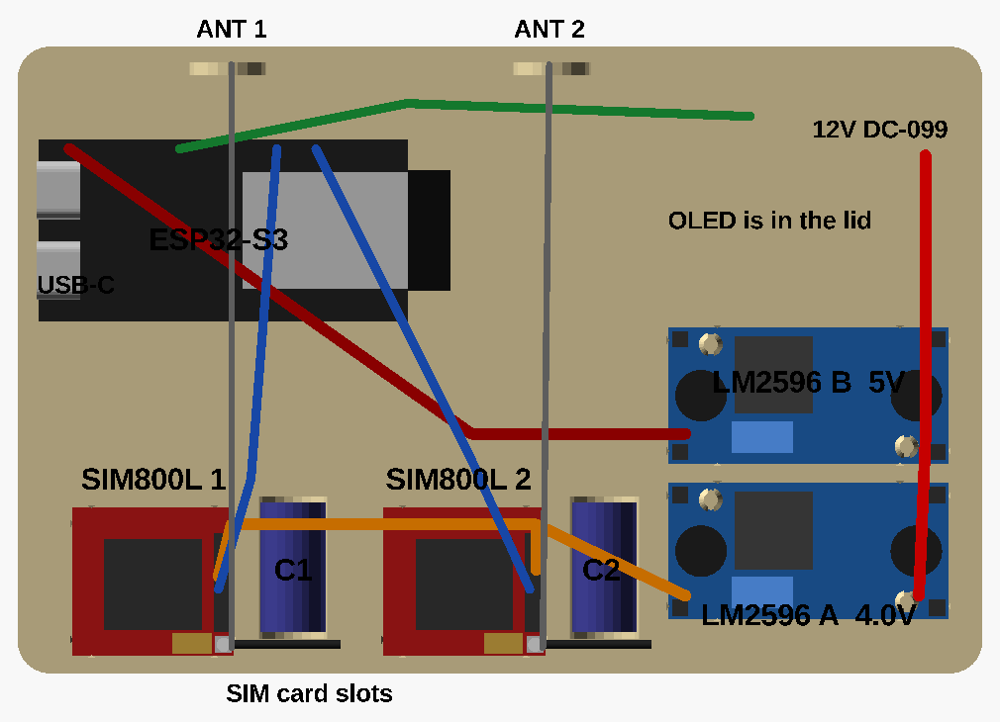
</p>

### v2 case (PCB)

| Front | Back |
|---|---|
| 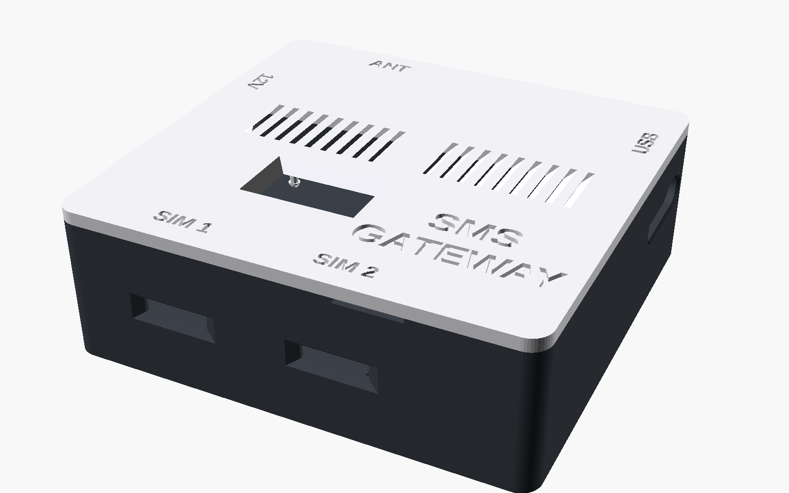 | 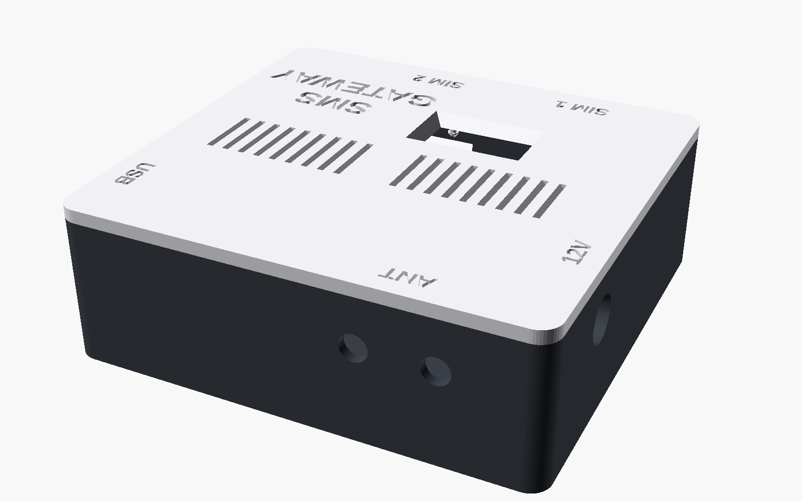 |
| **Inside** | **X-ray (lid transparent)** |
| 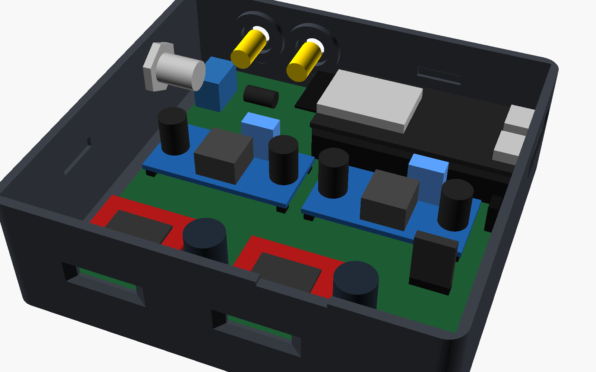 | 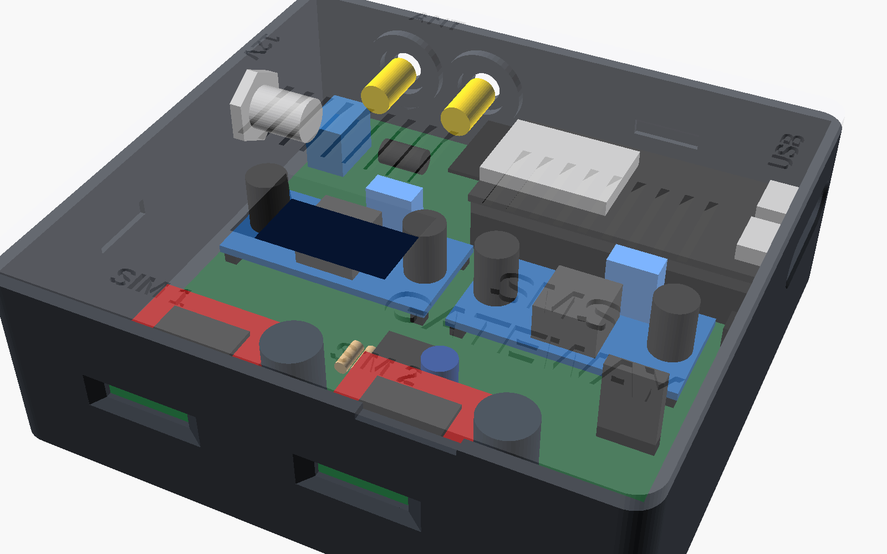 |

Outside size 113.2 x 105.8 x 35 mm + 3.2 mm lid. The PCB clicks onto 4 snap pins in its corner
holes, and 10 posts underneath keep it flat when you plug the modules in. The SIM cards go in
through the front wall, USB-C through the right wall, the 12 V jack sits in the left wall (two short
wires to the screw terminal), and the antennas go in the back wall. The OLED clicks into the lid,
with 4 jumpers to the PCB's OLED header.

1. **Fit tests first**: `case/v2/v2_fit_pin.stl` (the PCB snap pin: a corner hole of the PCB must
   click over it), `v2_fit_latch.stl` and `v2_fit_ant.stl` (same as v1).
2. **Box**: `case/v2/v2_base.stl` (opening up).
3. **Lid**: `case/v2/v2_lid.stl` (face down). For two colours, load `v2_lid_text.stl` with it as
   one object and give the letters filament 2. The OLED plug holder is `v2_dupont4.stl`.

Same print settings as v1.

### Changing sizes

Each case comes from its own file: `source/sms_gateway_box_v1.scad` or
`source/sms_gateway_box_v2.scad` (OpenSCAD 2021.01 or newer). Edit the numbers at the top, then
export a part from the command line:

```sh
openscad -D 'part="base"' -o v1_base.stl source/sms_gateway_box_v1.scad
openscad -D 'part="base"' -o v2_base.stl source/sms_gateway_box_v2.scad
```

v1 parts: `base`, `lid`, `lid_text`, `dupont4` (OLED plug holder), `fit_latch`, `fit_ant`,
`fit_buck`, `fit_esp`, `fit_sim`, `fit_oled`, `fittest`. v2 parts: `base`, `lid`, `lid_text`,
`dupont4`, `fit_pin`, `fit_latch`, `fit_ant`. Previews: `assembly`, `exploded`, `closed`.
`check` shows any part of a board that runs into the case; it must come out empty.

| If... | Change |
|---|---|
| The lid is too hard to open / falls off | `latch_e` (0.8): lower to 0.6 / raise to 1.0 |
| A SIM800L is too tight / loose in its bay | `sim_rib` (0.45): lower / raise |
| A thick USB-C plug does not click in | `usb_plug` (recess size), e.g. `[14, 8]` |
| You use a DC-022B jack instead of DC-099 | `dc_d` = 8.2 (11.2 for DC-099) |
| The OLED pegs miss its holes | measure the hole spacing into `oled_hole` |
| The OLED snap pins break | v1: `oled_snap = false` for plain pegs, melt the tips with a soldering iron |
| v2: the SIM card misses the holder | `sim_card_z` (card height), or `sock_h` / `pin_h` if your headers are taller or shorter than 8.5 / 2.5 mm |
| v2: the USB-C plugs do not reach the sockets | `usb_zc` (socket height), `usb_extra` (opening size) |
| v2: the PCB is too tight / loose on its snap pins | `pcb_pin` (shaft, barb, slot) |

**Not measured yet** (estimated from photos and maker CAD models, print the fit tests first):
OLED hole spacing (22.9 x 23.3), LM2596 hole and pad positions, SIM800L board size (25 x 23),
capacitor size, and for v2 the height of the plugged-in modules. Fit-test results and fixes are
welcome as issues or pull requests.

## Wiring

**v2:** the PCB does all of it, with the same pins as below. You only add the two 12 V wires from
the jack to the screw terminal and the 4 OLED jumpers.

**v1:** every wire, pin by pin ([full size](docs/wiring_v1.png), [SVG](docs/wiring_v1.svg)):

<p align="center">
  <a href="docs/wiring_v1.png">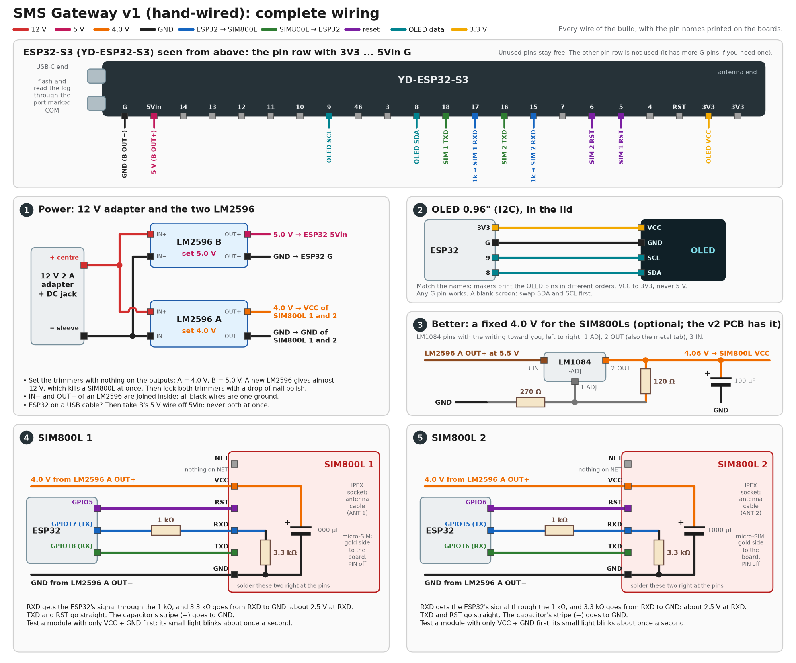</a>
</p>

[ASSEMBLY.md](ASSEMBLY.md) has the same as tables. In short:

- 12 V jack to both LM2596 inputs. **Set the outputs before connecting anything**: A = 4.0 V (both
  SIM800Ls, never above 4.2 V), B = 5.0 V (ESP32). A new LM2596 can output almost 12 V, and 12 V
  kills a SIM800L at once. Lock the trimmers with a drop of nail polish, or add the fixed 4.0 V
  regulator described in ASSEMBLY.md.
- A 1000 uF capacitor soldered at each SIM800L's VCC/GND (2 A transmit bursts).
- ESP32 TX to SIM800L RXD through a 1 k / 3.3 k divider; SIM800L TXD straight to the ESP32 RX.
- SIM1: GPIO17 TX, GPIO18 RX, GPIO5 RST. SIM2: GPIO15 TX, GPIO16 RX, GPIO6 RST. OLED: GPIO8 SDA, GPIO9 SCL.
- SIM800L pins in header order: NET VCC RST RXD TXD GND. Micro-SIM, gold contacts toward the board.

Something not working ("not answering", "no SIM card", no light on the SIM800L)? See
[ASSEMBLY.md → When something does not work](ASSEMBLY.md#when-something-does-not-work).

**Before you build, read [LESSONS.md](LESSONS.md)**: the mistakes made on the first build (a 12 V
spark that killed two SIM800Ls, resistors in the wrong place, a SIM card upside down, a server that
forgot everything on each deploy) and how to avoid them.

## Firmware

### Gateway: `firmware/sms_gateway/`

The program for the ESP32-S3 in the box. It runs both SIM800L modules, shows the status on the
OLED and the RGB LED, and syncs with the server, which does all the SMS work.
Full guide: [firmware/sms_gateway/README.md](firmware/sms_gateway/README.md).

- Arduino IDE 2 with the "esp32" core by Espressif (tested with 3.0.7), plus the **ArduinoJson 7**
  and **Adafruit SSD1306** libraries.
- Board "ESP32S3 Dev Module", Flash 16MB, Partition "16M Flash (3MB APP/9.9MB FATFS)", PSRAM "OPI
  PSRAM". Upload through the USB-C port marked COM.
- **First setup**: the gateway opens a `SMS-Gateway-XXXX` hotspot (password `smsgateway`). Join it
  with your phone, choose your Wi-Fi and enter your server address. The page and the OLED show the
  gateway's own **device key**: add it in the panel under Devices → Add a gateway.
- **Hold BOOT for 5 s** to erase the Wi-Fi and server settings and open the setup hotspot again
  (the device key stays, so the panel keeps knowing the gateway).

### Bench test: `firmware/sim800_test/`

Tests one ESP32-S3 + one SIM800L before anything goes in the box: it checks UART, supply voltage,
SIM, network registration and signal, prints PASS/FAIL with hints, then works as an AT terminal
(`!sms +<number> text` sends a test SMS). Serial Monitor at 115200 baud; wiring is in the comment
at the top of the sketch.

## Server

Node.js 24+ server and web panel in `server/`. No npm dependencies: Node's built-in `http`,
`crypto` and `node:sqlite`, and a vanilla-JS panel with hand-made SVG charts.
Full guide (Coolify steps, API, webhooks, data retention): [server/README.md](server/README.md).

```sh
cd server
ADMIN_PASSWORD=change-me npm start   # web panel on http://localhost:3000
npm test
```

**Deploy with Docker Compose** (e.g. Coolify): `docker-compose.yaml` at the repository root builds
`server/` and keeps the SQLite database in the named volume `gateway-data` (mounted at `/data`), so
it survives redeploys. In Coolify use the Build Pack "Docker Compose" and set the service domain
with the port, like `https://sms.example.com:3000`. Plain Docker: `ADMIN_PASSWORD=change-me docker compose up -d`.

| Env var | |
|---|---|
| `ADMIN_PASSWORD` | panel login; if unset, one is generated and printed in the logs |
| `API_KEY` | optional; generated and shown in the panel's Settings if unset |
| `SESSION_SECRET` | optional |
| `PORT`, `DATA_DIR` | default 3000 and `./data` (`/data` in Docker) |

**Device protocol**: the ESP32 sends `POST /api/device/sync` with `Authorization: Bearer <its device key>`
(the key the gateway made itself and the owner added under Devices) every few seconds, with device and SIM status plus events (incoming SMS as raw PDUs, missed calls,
job results). The reply carries the jobs to run (outgoing SMS as ready-made PDUs, AT commands,
restart). All SMS encoding and decoding (GSM-7 / UCS-2, multipart) happens on the server.

**Public API** for other apps, `Authorization: Bearer <API_KEY>`:

| | |
|---|---|
| `POST /api/v1/sms` | send: `{"to": "+15551234567", "text": "Hello", "sim": 0}` (`sim` 0 = any, 1, 2) |
| `GET /api/v1/sms/:id` | status of one message |
| `GET /api/v1/messages?direction=in&since_id=` | inbox / outbox (filters: `sim`, `device`, `since`, `until`, `q`) |
| `GET /api/v1/calls` | missed calls (same filters) |
| `GET /api/v1/messages.csv`, `GET /api/v1/calls.csv` | the same as a CSV file |
| `GET /api/v1/status` | gateway and SIM status, with the last balance |

**Webhooks** (URL set in the panel): `sms.received`, `sms.sent`, `sms.failed`, `call.missed`,
`device.offline`, `device.online`, signed with HMAC-SHA256 in the `X-Gateway-Signature` header.

**Telegram** (Settings → Telegram): paste a bot token from @BotFather and choose, for each SIM,
the chats that get its SMS and missed calls, all of them or only one-time codes. A long SMS
arrives as one message, joined from its parts. Reply to an SMS to answer it from the same SIM, or
send `/send +15551234567 text`. Send `/stats` for the status of every gateway and SIM, `/balance`
for the balance, and turn on alerts for a gateway that goes offline or a SIM that loses the
network. The server does all of this; the gateway does not talk to Telegram. Details in
[server/README.md](server/README.md#telegram).

## Contributing

Issues and pull requests are welcome, especially fit-test photos of the cases, reports from a
built v2 PCB, reports from running the firmware on real hardware, and support for 4G modules
(A7670 and similar) for countries without 2G.

## License

[MIT](LICENSE)
