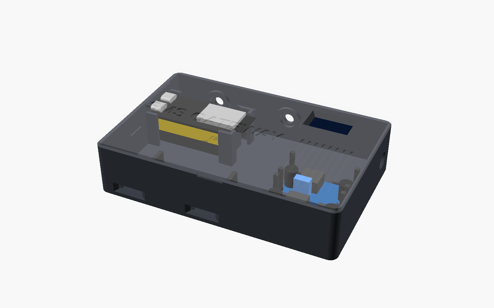

# SmsGateway

A DIY two-SIM **SMS and missed-call gateway**: an ESP32-S3 with two SIM800L GSM modules in a
3D-printed, screwless case, plus a self-hosted Node.js server with a web panel.

<p align="center">
  
</p>

| Front | Back |
|---|---|
|  |  |
| **Inside** | **X-ray (lid transparent)** |
|  |  |

All images are rendered from the OpenSCAD source in `source/`.

## Features

- **Two SIM cards**, each on its own SIM800L, cards slide in from the outside through the front wall.
- **External antennas**: IPEX to SMA bulkhead cables, SMA sockets in the back wall.
- **0.96" OLED** in the lid for status.
- **Screwless case**: snap latches on the lid, snap pins for the boards, crush ribs, no inserts.
- **Powered from 12 V** through two LM2596 bucks (4.0 V for the modems, 5 V for the ESP32).
- **Server + web panel** (Node.js, SQLite): SMS inbox/outbox, calls, device status, HTTP API, webhooks.

> **2G only.** The SIM800L is a 2G (GSM) module. Many countries have already switched 2G off.
> Check your operator before you build one, see [2G shutdowns](SHOPPING_LIST.md#6-caution-2g-shutdowns).

## Project status

| Part | State |
|---|---|
| Case v6 | Designed and sliced, **not yet print-tested**. Some sizes are estimated from photos (see below) |
| Wiring | Documented in [ASSEMBLY.md](ASSEMBLY.md) |
| Firmware | Bench-test sketch for one ESP32-S3 + one SIM800L. Gateway firmware: work in progress |
| Server | Working: web panel, HTTP API, webhooks, 19 passing tests. Not yet run against real hardware |

## Repository layout

```
case/v6/            print files: STL + 3MF of every part, Bambu Studio projects, renders
case/v6/bambu/      ready-to-print Bambu Studio plates + the process profile
source/             OpenSCAD source of the case (sms_gateway_box_v6.scad)
firmware/           Arduino sketches (sim800_test: bench test)
server/             Node.js server and web panel
ASSEMBLY.md         where every part sits, power and signal wiring, assembly order
SHOPPING_LIST.md    parts list, antennas, power notes, SIM cards, 2G shutdowns
```

## Hardware

| Part | Qty |
|---|---|
| ESP32-S3 dev board (YD-ESP32-S3, 2x USB-C, 28 mm wide) | 1 |
| SIM800L module with IPEX antenna socket | 2 |
| LM2596 buck module (43 x 21 mm) | 2 |
| 0.96" SSD1306 I2C OLED, 128x64, 4 pins (VCC GND SCL SDA) | 1 |
| 1000 uF low-ESR electrolytic capacitor (max 10.5 x 21 mm) | 2 |
| Resistors 1 k and 3.3 k (RX level dividers) | 2 + 2 |
| IPEX (u.FL) to SMA-female bulkhead cable, 12-15 cm | 2 |
| GSM antenna, SMA **male** (not RP-SMA) | 2 |
| DC-099 panel jack 5.5 x 2.1 mm + 12 V 2 A adapter | 1 |
| Female-female Dupont jumpers, 20 cm | ~20 |
| Micro-SIM with voice + SMS, works on 2G, PIN lock off | 2 |

Full list with alternatives and search terms: [SHOPPING_LIST.md](SHOPPING_LIST.md).

## 3D-printed case (v6)

Outside size 148.8 x 96.8 x 32.4 mm + 3.2 mm lid. Printed in PLA on a 0.4 mm nozzle, no supports.

1. **Fit tests first**: `case/v6/bambu/1_fit_tests_X2D.3mf` (lid latch, LM2596, SIM800L, OLED,
   ESP32, antenna hole + the OLED plug holder). Check every board fits. On the antenna test, fit
   the real SMA connector (body in the pocket inside, washer + nut outside) and screw the antenna on.
2. **Box**: `case/v6/bambu/2_box_X2D.3mf` (opening up).
3. **Lid**: `case/v6/bambu/3_lid_X2D.3mf` (face down). For two colours, drag `v6_lid.stl` and
   `v6_lid_text.stl` into Bambu Studio together, answer "Yes" (one object), give the letters filament 2.

The Bambu projects are set up for a Bambu Lab X2D. For other printers, use the plain `.stl`/`.3mf`
files in `case/v6/`. Settings: 0.20 mm layers, 3 walls, 5 top / 4 bottom shells, 15% gyroid, no
supports (profile: `case/v6/bambu/SMS case 0.20mm @BBL X2D.json`). Print times on an X2D: fit tests
~3 h, box ~6.5 h, lid ~3 h.

<p align="center">
  
</p>

### Changing sizes

Everything comes from `source/sms_gateway_box_v6.scad` (OpenSCAD 2021.01 or newer). Edit the
numbers at the top, then export a part from the command line:

```sh
openscad -D 'part="base"' -o v6_base.stl source/sms_gateway_box_v6.scad
```

Parts: `base`, `lid`, `lid_text`, `dupont4` (OLED plug holder), `fit_latch`, `fit_ant`, `fit_buck`,
`fit_esp`, `fit_sim`, `fit_oled`, `fittest`. Previews: `assembly`, `exploded`, `closed`.

| If... | Change |
|---|---|
| The lid is too hard to open / falls off | `latch_e` (0.8): lower to 0.6 / raise to 1.0 |
| A SIM800L is too tight / loose in its bay | `sim_rib` (0.45): lower / raise |
| A thick USB-C plug does not click in | `usb_plug` (recess size), e.g. `[14, 8]` |
| You use a DC-022B jack instead of DC-099 | `dc_d` = 8.2 (11.2 for DC-099) |
| The OLED pegs miss its holes | measure the hole spacing into `oled_hole` |
| The OLED snap pins break | `oled_snap = false` for plain pegs, melt the tips with a soldering iron |

**Not measured yet** (estimated from photos and maker CAD models, print the fit tests first):
OLED hole spacing (22.9 x 23.3), LM2596 hole and pad positions, SIM800L board size (25 x 23),
capacitor size. Fit-test results and fixes are welcome as issues or pull requests.

## Wiring

See [ASSEMBLY.md](ASSEMBLY.md) for the full tables. In short:

- 12 V jack to both LM2596 inputs. **Set the outputs before connecting anything**: A = 4.0 V (both
  SIM800Ls, never above 4.2 V), B = 5.0 V (ESP32). A new LM2596 can output almost 12 V.
- A 1000 uF capacitor soldered at each SIM800L's VCC/GND (2 A transmit bursts).
- ESP32 TX to SIM800L RXD through a 1 k / 3.3 k divider; SIM800L TXD straight to the ESP32 RX.
- SIM1: GPIO17 TX, GPIO18 RX, GPIO5 RST. SIM2: GPIO15 TX, GPIO16 RX, GPIO6 RST. OLED: GPIO8 SDA, GPIO9 SCL.

## Firmware

`firmware/sim800_test/sim800_test.ino` tests one ESP32-S3 + one SIM800L on the bench before
anything goes in the box: it checks UART, supply voltage, SIM, network registration and signal,
prints PASS/FAIL with hints, then works as an AT terminal (`!sms +<number> text` sends a test SMS).

- Arduino IDE with the ESP32 core, board "ESP32S3 Dev Module".
- Upload through the USB-C port marked COM, Serial Monitor at 115200 baud.
- Wiring is in the comment at the top of the sketch.

## Server

Node.js 24+ server and web panel in `server/`. No npm dependencies: Node's built-in `http`,
`crypto` and `node:sqlite`, and a vanilla-JS panel with hand-made SVG charts.

```sh
cd server
ADMIN_PASSWORD=change-me npm start   # web panel on http://localhost:3000
npm test
```

**Deploy with Docker** (e.g. Coolify): use `server/Dockerfile` (base directory `/server`, port
3000) and mount a persistent volume at `/data` for the SQLite database.

| Env var | |
|---|---|
| `ADMIN_PASSWORD` | panel login; if unset, one is generated and printed in the logs |
| `DEVICE_KEY`, `API_KEY` | optional; generated and shown in the panel's Settings if unset |
| `SESSION_SECRET` | optional |
| `PORT`, `DATA_DIR` | default 3000 and `./data` (`/data` in Docker) |

**Device protocol**: the ESP32 sends `POST /api/device/sync` with `Authorization: Bearer <DEVICE_KEY>`
every few seconds, with device and SIM status plus events (incoming SMS as raw PDUs, missed calls,
job results). The reply carries the jobs to run (outgoing SMS as ready-made PDUs, AT commands,
restart). All SMS encoding and decoding (GSM-7 / UCS-2, multipart) happens on the server.

**Public API** for other apps, `Authorization: Bearer <API_KEY>`:

| | |
|---|---|
| `POST /api/v1/sms` | send: `{"to": "+15551234567", "text": "Hello", "sim": 0}` (`sim` 0 = any, 1, 2) |
| `GET /api/v1/sms/:id` | status of one message |
| `GET /api/v1/messages?direction=in&since_id=` | inbox / outbox |
| `GET /api/v1/calls` | missed calls |
| `GET /api/v1/status` | gateway and SIM status |

**Webhooks** (URL set in the panel): `sms.received`, `sms.sent`, `sms.failed`, `call.missed`,
`device.offline`, `device.online`, signed with HMAC-SHA256 in the `X-Gateway-Signature` header.

## Contributing

Issues and pull requests are welcome, especially fit-test photos of the case, firmware for the
gateway, and support for 4G modules (A7670 and similar) for countries without 2G.

## License

[MIT](LICENSE)
