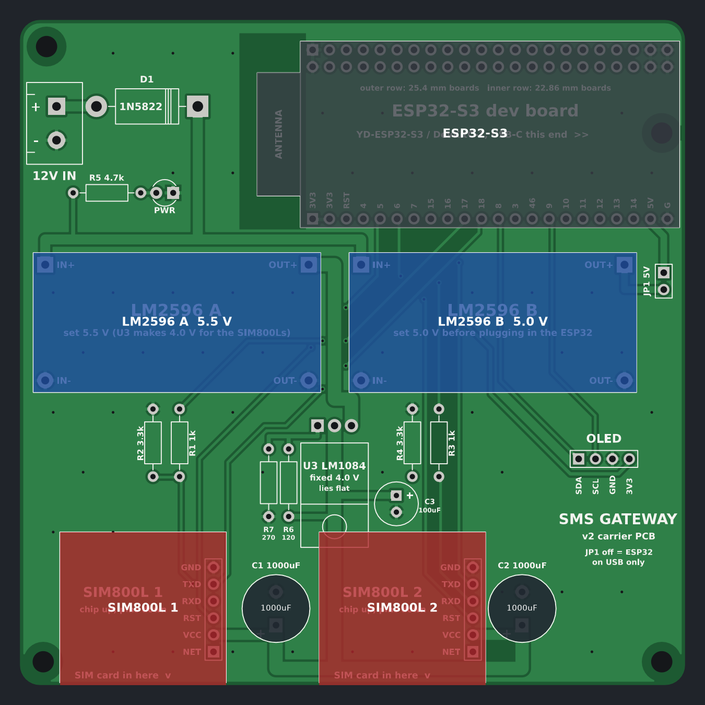
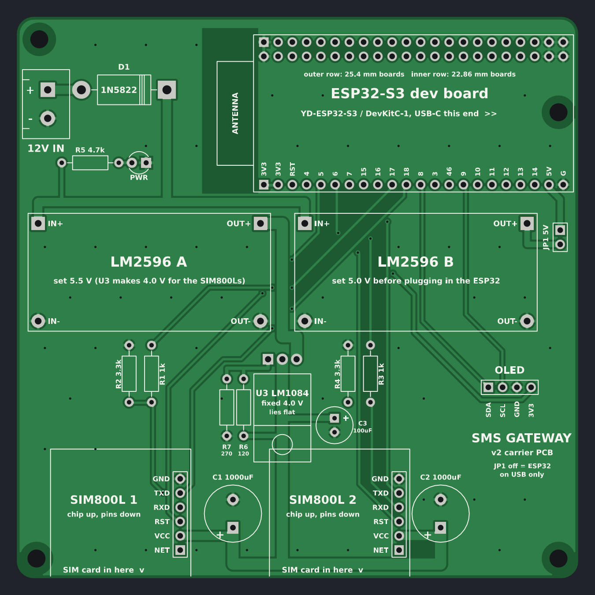
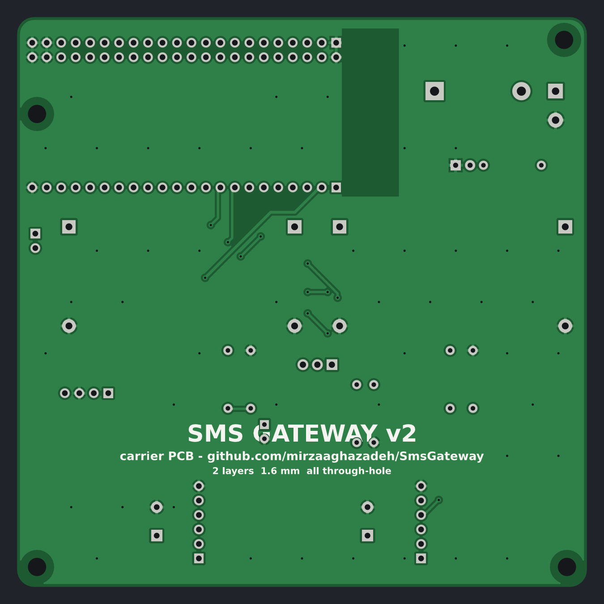

# SMS Gateway v2: the carrier PCB

v2 is the PCB build of the gateway. The modules plug into one board, so there is no loose wiring:
the ESP32-S3 dev board, both SIM800Ls, both LM2596s and the OLED. It goes into the v2 case
(`case/v2/`). The firmware and the server are the same for v1 and v2.

<p align="center">
  
</p>

| Top | Bottom |
|---|---|
|  |  |

- 100 x 100 mm, 2 layers, 1.6 mm, **all through-hole**, so it is easy to solder by hand.
- Same pins as the firmware: SIM1 TX 17 / RX 18 / RST 5, SIM2 TX 15 / RX 16 / RST 6,
  OLED SDA 8 / SCL 9.
- 12 V comes in on a screw terminal, through a 1N5822 diode that protects against reversed
  polarity, to both LM2596s: A (5.5 V) for the SIM800Ls, B (5.0 V) for the ESP32.
- **The SIM800Ls get a fixed 4.06 V** from U3, an LM1084 regulator behind LM2596 A. Whatever A's
  trimmer is set to, up to the full 12 V, the SIM800Ls (4.4 V max) are safe. On the first
  hand-wired build an LM2596 turned up to 12 V killed both modules; this is the fix.
- The 1000 uF capacitors and the 1k / 3.3k RX dividers are on the board.
- **JP1** connects the 5 V of LM2596 B to the ESP32. Take the jumper off when the ESP32 runs on
  USB only.
- Ground fill on both sides. The design check finds no errors: every gap is at least 0.25 mm, and
  every connection is complete.

## Ordering: everything is ready

You can order bare boards and solder them yourself, or order them **assembled (PCBA)** by the
factory. Everything a factory needs is already in this folder.

**Bare boards.** Upload `sms_gateway_v2_gerbers.zip` to any PCB maker (JLCPCB, PCBWay, ...) and keep
the defaults: 2 layers, 1.6 mm, HASL, any colour. 5 or 10 boards of this size usually cost a few
dollars plus shipping.

**Assembled boards (PCBA).** Send `sms_gateway_v2_order_package.zip` to the factory. It holds:

| File | What |
|---|---|
| `sms_gateway_v2_order_specs.txt` | Board and assembly specs, written as a request for a quote |
| `sms_gateway_v2_gerbers.zip` | Gerber and drill files |
| `sms_gateway_v2_BOM.xlsx` (`.csv`) | Parts list with values, packages, polarity notes |
| `sms_gateway_v2_pick_and_place.xlsx` (`.csv`) | Where each part sits (origin bottom-left, mm) |
| `sms_gateway_v2_assembly_drawing.pdf` | Drawing with part names, polarity arrows and "do not place" marks |
| `render_top.png`, `render_bottom.png` | Pictures of the board |

Notes for the order:

- All parts are through-hole. Chinese factories call through-hole assembly **"DIP"**. There are
  20 parts and 91 solder joints per board, and no stencil is needed.
- The factory buys all the parts ("turnkey"). The **LM2596 modules are marked "do not place"**,
  since you set their voltage yourself. The specs ask for an optional extra price for fitting them.
- The ESP32 board and the SIM800Ls are not part of the order. They plug in later.
- Write your country in the specs file (the "shipping cost to" line) before you send it.
- Ask for a photo of the first board before they ship.

A message you can send with the zip:

> Hello, please quote PCB fabrication + turnkey assembly for the attached design, 10 pcs (and 20).
> 2 layers, FR-4, 100 x 100 mm, 1.6 mm, 1 oz, HASL, green/white. Assembly: all through-hole (DIP),
> top side only, 20 parts / 91 solder joints per board, you source all parts (equivalents OK).
> U1/U2 are not placed. Details are in the specs file and the assembly drawing. Please also quote
> the bare PCB, the lead time and the shipping.

## Building it yourself

1. Solder the low parts first: R1-R7 (no polarity; R6 = 120 Ω, R7 = 270 Ω), D1 (band = cathode at
   the square pad), the LED (short leg in the square pad), then C1/C2/C3 (+ leg in the square pad).
   **U3 lies flat** in its outline: bend its three legs 90° about 3 mm from the body, plastic face
   down and metal tab up, pin 1 (ADJ) in the square pad. No heatsink, no screw.
2. The headers: J1 and J2 for the ESP32 (1x22 female; **J2 goes in the outer hole row**, the one
   at the board edge, for the 28 mm wide YD-ESP32-S3; use the inner row only for a 25.4 mm wide
   board), J3/J4 for the SIM800Ls (1x6 female), J6 for the OLED (1x4 male), JP1 (1x2 male + jumper)
   and the screw terminal J5.
3. The two LM2596 modules: put 4 single male header pins into the board's corner holes, plastic
   spacer down, set the module on them and solder both sides. **Line up the IN+ / OUT+ labels on
   the PCB with the labels on the module.**
4. **Set the voltages with nothing plugged in:** connect 12 V and turn the trimmers until
   LM2596 A reads **5.5 V** and B reads **5.0 V** on their OUT+ / OUT- pads (5.3-6 V for A is fine).
   Then check the SIM supply: **4.0-4.1 V** between VCC and GND of a SIM800L socket (J3/J4). Lock
   both trimmers with a drop of nail polish.
5. Plug in the modules. The ESP32 goes in with its USB-C at the right edge. The SIM800Ls go in
   chip up and pins down, with the SIM card edge at the board edge. Their 6-pin header must be
   soldered pointing **down**, on the SIM-holder side. Connect the OLED with 4 F-F jumpers
   (SDA-SDA, SCL-SCL, GND-GND, 3V3-VCC).

The board clicks into the v2 case (`case/v2/`, see the main README) on 4 snap pins.

## Check before you order

Some sizes are estimates, the same ones the v1 case uses. Print `render_top.png` at 100 % and lay
your real modules on it.

- **ESP32 row spacing.** 25.4 mm for the YD-ESP32-S3, 22.86 mm for Espressif's drawing. The board
  has holes for both.
- **SIM800L header position.** 1.9 mm from the module edge, with NET 5 mm from the SIM card edge.
  This only changes where the module overhangs, not the wiring.
- **LM2596 corner pads.** 39.6 x 17.4 mm apart. If yours differ, bend the pin legs or use short
  wires.

## Files and regenerating

Everything here is generated by `make_board.py`: the board layout, the routing, the ground fill,
the design check and every output file. Edit it and run it again:

```sh
pip install shapely matplotlib numpy openpyxl
python3 make_board.py
```

`render_nets.png` shows every connection in its own colour, which is handy for checking a change.
`sms_gateway_v2.kicad_pcb` is written for editing in KiCad 8 or newer. It has not been opened in
KiCad yet, so press B to fill the ground zones after loading. The Gerber files are the reference.
